# Sex-chromosome dosage in Drosophila simulans

**Name:** Gedden D. Estrevillo | **Section:** A | **Course:** Cell and Molecular Biology, individual practical exercise

## 1. Species and study question

I chose the fruit fly *Drosophila simulans*. Flies use an XY sex system, so a male has one X chromosome and a female has two.

**Study question:** When I map whole-genome DNA reads from a fly sample onto the reference genome, does the X chromosome have about the same read depth as the autosomes (two copies, XX-like) or about half of it (one copy, XY-like)?

## 2. Accessions

| Item | Accession | Link |
|---|---|---|
| Assembly | GCF_016746395.2 (Prin_Dsim_3.1, GenBank GCA_016746395.2) | https://www.ncbi.nlm.nih.gov/datasets/genome/GCF_016746395.2/ |
| Assembly BioSample | SAMN06473875 (strain w501) | https://www.ncbi.nlm.nih.gov/biosample/SAMN06473875 |
| WGS run | SRR15202879 (experiment SRX11509383) | https://www.ncbi.nlm.nih.gov/sra/SRR15202879 |
| WGS BioSample | SAMN20331739 (strain wXD1, male) | https://www.ncbi.nlm.nih.gov/biosample/SAMN20331739 |
| WGS BioProject | PRJNA748438 | https://www.ncbi.nlm.nih.gov/bioproject/PRJNA748438 |

**Same donor?** No. The assembly DNA came from about 600 females of strain w501. The reads came from 30 virgin males of strain wXD1. My result is about the WGS sample only.

**Reads:** Illumina HiSeq 2500, paired-end, 125 bp reads, 58.4 million read pairs, 14.7 Gb. The library was made with a PCR-free Illumina kit, according to the submitter's description.

**Sex system:** XY. **Sex-chromosome check:** the NCBI chromosome table for this assembly lists the X by name, next to 2L, 2R, 3L, 3R and 4. There is no Y in this assembly, and Y is optional in this lab.

Screenshots: 

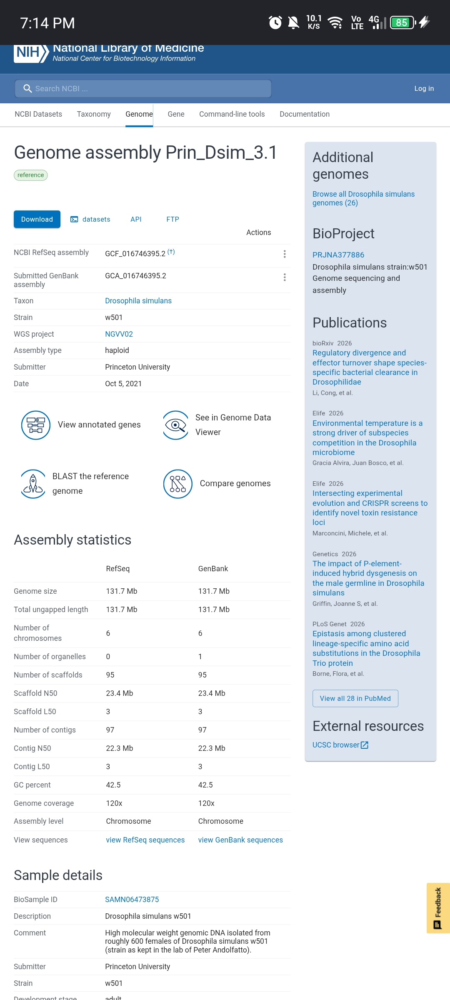

 

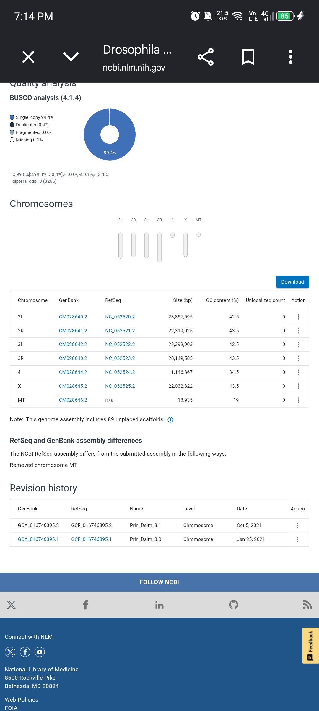

 

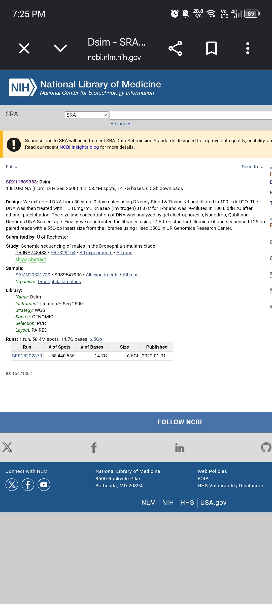

 

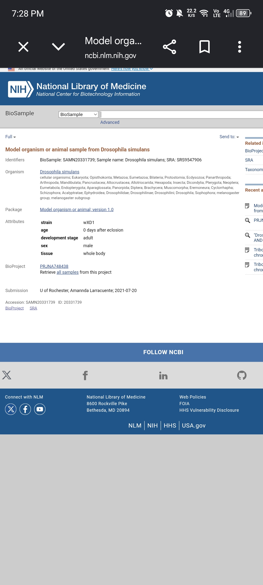


## 3. Galaxy workflow (usegalaxy.org)

**Galaxy history:** [https://galaxy-main.usegalaxy.org/u/ged_den/h/sex-dosage-drosophila-simulans]

History name: `Sex_Dosage_Drosophila_simulans`

| Step | Tool | Settings |
|---|---|---|
| 1 | Upload | The RefSeq genomic FASTA `GCF_016746395.2_Prin_Dsim_3.1_genomic.fna`, type fasta. I used the RefSeq file so the names (NC_...) match my groups file |
| 2 | Faster Download and Extract Reads in FASTQ (fasterq-dump) | Accession SRR15202879. Output: a paired collection |
| 3 | seqtk_sample (Galaxy version 1.5+galaxy0) | Run on both read files with seed 100 and 5,300,000 reads each, so the pairs stay matched. This gives about 10x depth on a 131.7 Mb genome |
| 4 | FastQC (Galaxy version 0.74+galaxy1) | On the subsampled forward and reverse files, default settings |
| 5 | Map with BWA-MEM (Galaxy version 0.7.19+galaxy1) | Reference from history (the FASTA above), index algorithm Auto, paired collection (the subsample), read groups not set, Simple Illumina mode, BAM sorted by chromosomal coordinates |
| 6 | Samtools flagstat | On the BAM |
| 7 | Samtools coverage | On the BAM. Tabular output, minimum mapping quality 20, minimum base quality 20 |

**Trimming:** I did not trim. FastQC found no adapter content and no reads flagged as poor quality, and BWA-MEM soft-clips weak read ends.

**Download note:** Galaxy gave me the coverage table inside a zip file because it was part of a collection. I unzipped it in R and saved the table as `chromosome_coverage.tsv` before running the analysis.

### FastQC summary

| | Forward | Reverse |
|---|---|---|
| Total sequences | 5,300,000 | 5,300,000 |
| Sequence length | 126 | 126 |
| %GC | 39 | 39 |
| Poor-quality sequences | 0 | 0 |
| Adapter content | Pass | Pass |
| Per base sequence quality | Warning | Fail (quality drops toward the read end, common for read 2) |


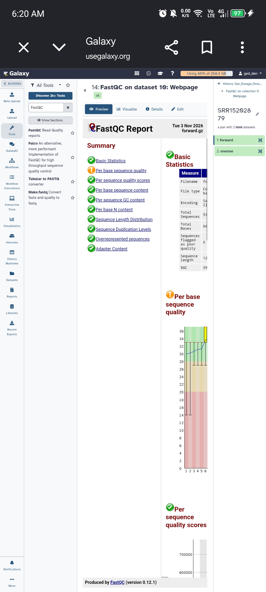

 

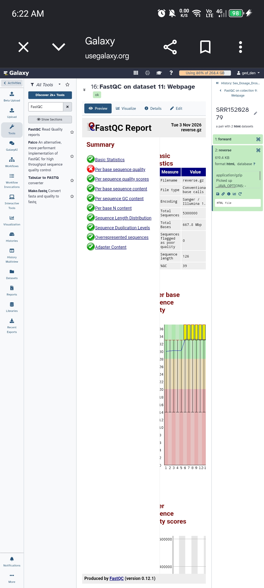


### Mapping summary (Samtools flagstat)

| Measure | Value |
|---|---|
| Reads in total | 10,664,273 |
| Primary reads | 10,600,000 (5,300,000 read 1 and 5,300,000 read 2) |
| Mapped | 10,128,614 (94.98%) |
| Properly paired | 9,698,620 (91.50%) |
| Singletons | 111,871 (1.06%) |


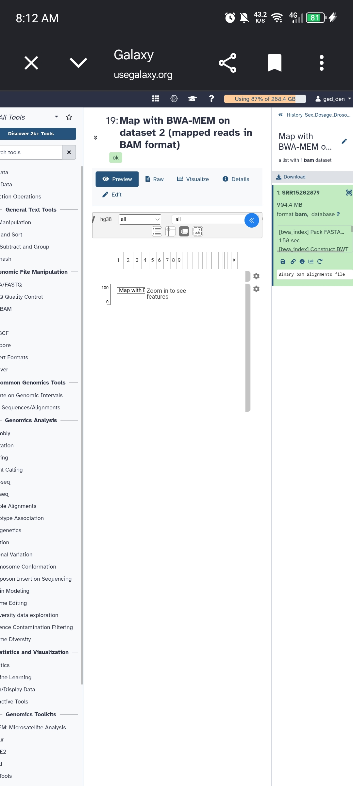

 

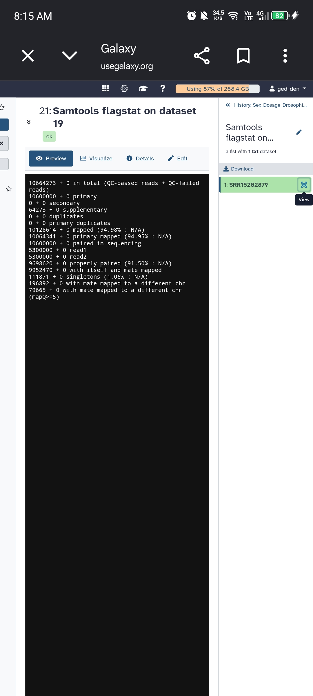

 

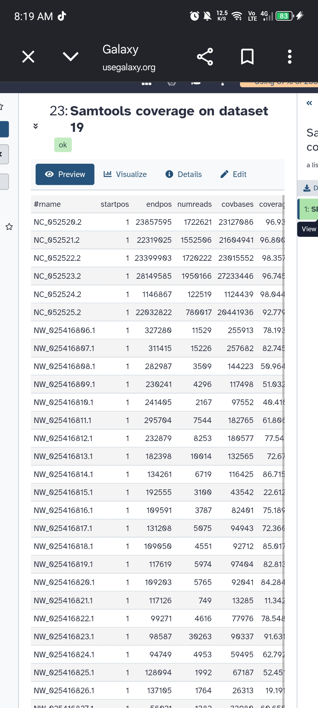


## 4. Chromosome groups

File: `chromosome_groups.csv`

```
rname,group
NC_052520.2,A
NC_052521.2,A
NC_052522.2,A
NC_052523.2,A
NC_052524.2,A
NC_052525.2,X
```

| rname | Chromosome | Group | Size (bp) | Why I chose it |
|---|---|---|---|---|
| NC_052520.2 | 2L | A | 23,857,595 | Named autosome in the NCBI chromosome table |
| NC_052521.2 | 2R | A | 22,319,025 | Named autosome |
| NC_052522.2 | 3L | A | 23,399,903 | Named autosome |
| NC_052523.2 | 3R | A | 28,149,585 | Named autosome |
| NC_052524.2 | 4 | A | 1,146,867 | Named autosome. It is very small, but I needed five autosomes |
| NC_052525.2 | X | X | 22,032,822 | The X is named in the table |

I checked each name against the NCBI chromosome table. The same RefSeq names appear in the `rname` column of the Samtools coverage file. I left out the mitochondrial genome and the 89 unplaced scaffolds. No Y was labelled.

## 5. R code

File: `sex_depth_analysis.R`. I ran it with `source("sex_depth_analysis.R")` in Posit Cloud (R 4.6.1), which gives the same result as `Rscript sex_depth_analysis.R`.

```r
# Sex-chromosome dosage from whole-genome DNA read depth
# Input: Samtools coverage TSV + student chromosome labels
cov <- read.delim("chromosome_coverage.tsv", comment.char = "",
check.names = FALSE, stringsAsFactors = FALSE)
names(cov)[1] <- "rname" # Accepts the '#rname' header
if (!"meandepth" %in% names(cov)) stop("Missing meandepth column")
key <- read.csv("chromosome_groups.csv", stringsAsFactors = FALSE)
if (!all(c("rname", "group") %in% names(key))) stop("Bad key columns")
key$rname <- trimws(key$rname)
key$group <- toupper(trimws(key$group))
if (anyDuplicated(key$rname)) stop("Repeated rname in key file")
if (!all(key$group %in% c("A", "X", "Y", "Z", "W")))
stop("Use only A, X, Y, Z or W in the group column")
x <- merge(key, cov[, c("rname", "meandepth")],
by = "rname", all.x = TRUE, sort = FALSE)
x$meandepth <- suppressWarnings(as.numeric(x$meandepth))
if (anyNA(x$meandepth)) stop("Missing depths: check rname matches")
if (any(x$meandepth < 0)) stop("Negative depth is not valid")
if (sum(x$group == "A") < 5) stop("Label at least 5 autosomes")
if ("X" %in% x$group && "Z" %in% x$group)
stop("Choose either an XY or a ZW species, not both")
if (sum(x$group == "X") == 1 && !any(x$group == "Z")) {
target <- "X"
one_copy <- "XY-like"
two_copies <- "XX-like"
} else if (sum(x$group == "Z") == 1 && !any(x$group == "X")) {
target <- "Z"
one_copy <- "ZW-like"
two_copies <- "ZZ-like"
} else stop("Label exactly one X or exactly one Z chromosome")
A <- median(x$meandepth[x$group == "A"])
if (!is.finite(A) || A <= 0) stop("No usable autosomal coverage")
x$relative_depth <- x$meandepth / A
ratio <- x$relative_depth[x$group == target]
call <- if (ratio >= 0.80) two_copies else if (ratio <= 0.65)
one_copy else "Ambiguous"
if (A < 1) call <- "Inconclusive: very low autosomal depth"
# Additional Y or W evidence can support, but not prove, a call
partner <- if (target == "X") "Y" else "W"
partner_ratio <- if (partner %in% x$group)
x$relative_depth[x$group == partner][1] else NA_real_
# Export results and a simple, reproducible figure
dir.create("results", showWarnings = FALSE)
write.csv(x, "results/chromosome_relative_depth.csv", row.names = FALSE)
png("results/chromosome_depth.png", width = 1000, height = 580)
par(mar = c(8, 4, 3, 1))
barplot(x$relative_depth, names.arg = x$rname, las = 2,
ylab = "Depth relative to median autosome",
main = "Autosomal and sex-chromosome depth", cex.names = 0.75)
abline(h = c(0.5, 1.0), lty = 2)
dev.off()
summary <- c(paste("Median autosome depth:", round(A, 3)),
paste(target, "/ A ratio:", round(ratio, 3)),
paste(partner, "/ A ratio:", round(partner_ratio, 3)),
paste("Dosage interpretation:", call),
"Compare with BioSample sex and discuss limitations.")
writeLines(summary, "results/sex_inference.txt")
cat(paste(summary, collapse = "\n"), "\n")
```

## 6. Results

Input table: `chromosome_coverage.tsv` (Samtools coverage output, 95 rows). Output files are in the `results/` folder.

| Chromosome | rname | Group | Mean depth | Relative to median autosome |
|---|---|---|---|---|
| 2L | NC_052520.2 | A | 7.398 | 1.000 |
| 2R | NC_052521.2 | A | 7.080 | 0.957 |
| 3L | NC_052522.2 | A | 7.514 | 1.016 |
| 3R | NC_052523.2 | A | 7.078 | 0.957 |
| 4 | NC_052524.2 | A | 11.263 | 1.523 |
| X | NC_052525.2 | X | 3.589 | 0.485 |

`results/sex_inference.txt`:

```
Median autosome depth: 7.398
X / A ratio: 0.485
Y / A ratio: NA
Dosage interpretation: XY-like
Compare with BioSample sex and discuss limitations.
```


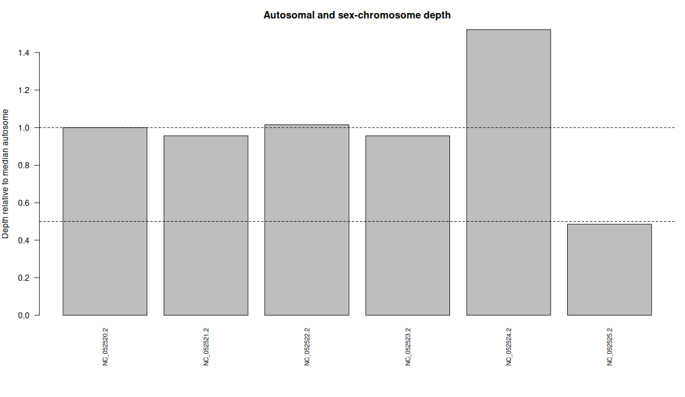


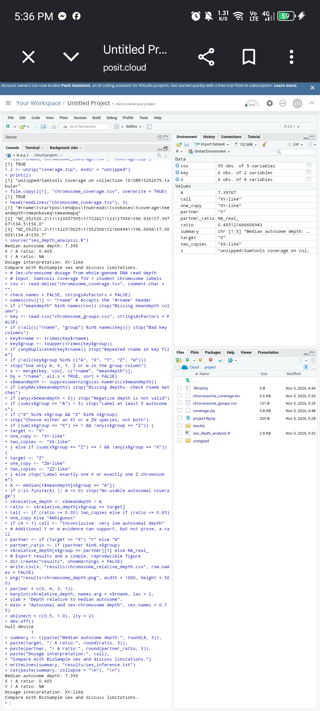


**Extra check:** chromosome 4 is small and has higher depth than the others. I repeated the calculation without it. The median of the four large autosomes is 7.239, and the X:A ratio becomes 0.496. The call is still XY-like. My main result still uses all five autosomes, as the lab asks.

## 7. Answers to the six questions

**1. What species did you choose, and what evidence supports a diploid XX/XY system?**
I chose *Drosophila simulans*. Fruit flies have an XY sex system. In NCBI, the chromosome table for the assembly lists the X chromosome by name, together with the autosomes 2L, 2R, 3L, 3R and 4. The assembly is a haploid representation of a diploid fly. [[ADD ONE SOURCE HERE that says D. simulans is diploid with XX/XY sex determination, for example FlyBase, the genome paper, or a textbook]]

**2. What are your accessions, and are the donors the same?**
Assembly GCF_016746395.2, assembly BioSample SAMN06473875, WGS run SRR15202879, WGS BioSample SAMN20331739. The donors are not the same. The assembly DNA came from about 600 females of strain w501. The reads came from 30 virgin males of strain wXD1. So my result describes the WGS male pool only.

**3. Which sequences were used as autosomes and as X, and how did you verify them?**
Autosomes: 2L (NC_052520.2), 2R (NC_052521.2), 3L (NC_052522.2), 3R (NC_052523.2) and 4 (NC_052524.2). X: NC_052525.2. I matched each name to the chromosome table on the NCBI assembly page, where they are listed as chromosomes 2L, 2R, 3L, 3R, 4 and X. The same RefSeq names appear in the Samtools coverage table. I did not use the mitochondrial genome or the 89 unplaced scaffolds.

**4. What are the median autosomal depth, X:A ratio, and inferred complement?**
The median autosomal depth is 7.398. The X:A ratio is 0.485. The script calls this XY-like, which means one X copy.

**5. Does your result agree with the recorded sex of the WGS donor?**
Yes. The BioSample says male (and the study design says 30 virgin 0-day males), and the result is XY-like with an X:A ratio near 0.5. I cannot compare it to the assembly donor, because that was a different sample (females). There is some uncertainty because the reads come from a pool, not one fly. Chromosome 4 also had higher depth (1.52), which is probably caused by its small size and repeats, but I did not test the reason. Dropping chromosome 4 gave 0.496, so it did not change the call.

**6. Why is a chromosome-level assembly alone not enough for a reliable read-depth sex inference?**
An assembly is one reference sequence. It tells me which chromosomes exist and how long they are, but not how many copies of each one a particular fly carries. A male and a female can be mapped to the same assembly. Only the read depth from that individual shows the dosage, because an X with one copy gets about half as many reads as an autosome with two.

## 8. Limitations

- The reads come from a pool of 30 males, not a single fly.
- The reads are from strain wXD1, but the reference is from strain w501, so some reads may map less well.
- The assembly donor (about 600 females) is a different sample, so I could not compare the result with it.
- Chromosome 4 is only 1.1 Mb and had higher depth, so its depth is noisy.
- No Y chromosome is in the assembly, so I have no Y:A ratio. A missing Y signal does not prove the Y is absent.
- The cutoffs in the script (0.80 and 0.65) are teaching guidelines, not diagnostic rules.
- Depth is about 10x before filtering (median 7.4 after the quality filters). The reverse reads failed the FastQC per-base quality check at later positions. I did not trim, and I did not mark duplicates.

## 9. Files in this repository

| File or folder | What it is |
|---|---|
| `README.md` | This report |
| `sex_depth_analysis.R` | The R script |
| `chromosome_coverage.tsv` | Samtools coverage table (input) |
| `chromosome_groups.csv` | My chromosome labels |
| `results/` | `chromosome_relative_depth.csv`, `chromosome_depth.png`, `sex_inference.txt` |
| `screenshots/` | Screenshots of each step |

No FASTQ, FASTA, BAM or CRAM files are included.

## 10. References

- NCBI Datasets genome: https://www.ncbi.nlm.nih.gov/datasets/genome/
- NCBI SRA: https://www.ncbi.nlm.nih.gov/sra
- Galaxy: https://usegalaxy.org
- Galaxy NGS training: https://training.galaxyproject.org/training-material/topics/introduction/tutorials/galaxy-intro-ngs-data-managment/tutorial.html
- Samtools coverage: https://www.htslib.org/doc/samtools-coverage.html
- Sex-chromosome coverage review: https://pmc.ncbi.nlm.nih.gov/articles/PMC6900093/
- FastQC: https://www.bioinformatics.babraham.ac.uk/projects/fastqc/
- BWA: https://github.com/lh3/bwa
- seqtk: https://github.com/lh3/seqtk
- Assembly BioProject PRJNA377886 (strain w501): https://www.ncbi.nlm.nih.gov/bioproject/PRJNA377886
- Reads BioProject PRJNA748438: https://www.ncbi.nlm.nih.gov/bioproject/PRJNA748438
